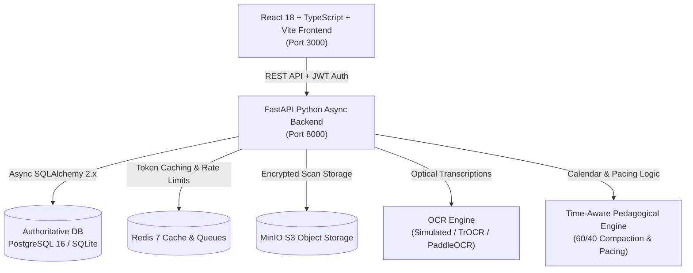
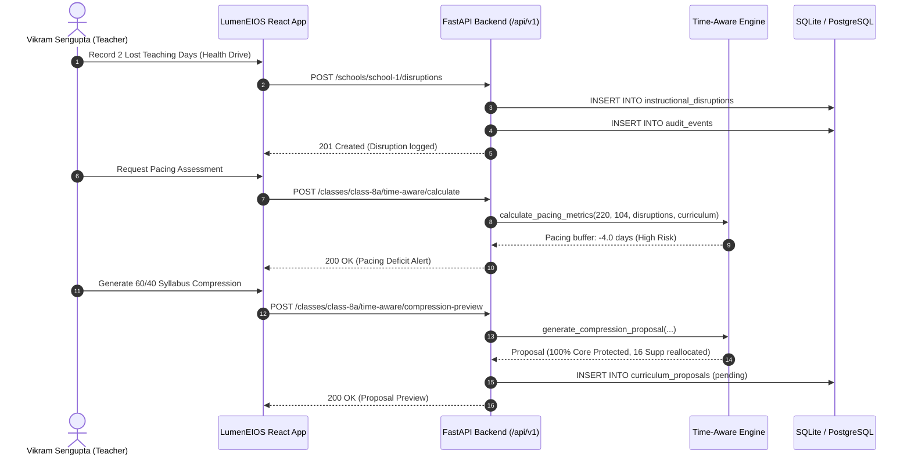

# LumenEIOS System Architecture

## 1. Executive Summary

LumenEIOS (Adaptive EdTech Ecosystem) is an AI-inspired educational operating system designed for Indian K-12 schools, strictly aligned with the National Education Policy (NEP 2020) competency-based learning framework. It bridges high-tech urban schools, hybrid institutions, and low-tech rural campuses through a multi-tenant, offline-first, time-aware pedagogical architecture.

---

## 2. Core Architectural Components

### 2.1 Frontend Presentation Layer
- **Framework**: React 18 with TypeScript and Vite.
- **Styling**: Tailwind CSS design system with customized professional education theme (`#142A43` primary navy, `#16A085` teal, `#F3F6F8` background).
- **Visualization**: Recharts for competency radar charts, pacing gauges, and historical baseline curves.
- **Offline / Local Resilience**: Seamless client-side state persistence backed by LocalStorage and async synchronization through `apiClient.ts`.

### 2.2 Backend Application Layer
- **Framework**: FastAPI (Python 3.12+ / 3.15 compatible) using asynchronous route handlers.
- **Validation**: Pydantic v2 schemas providing bidirectional request parsing, response serialization, and typed validation.
- **Security & Authorization**: JWT token lifecycle (HS256) with role enforcement across 5 personas (`admin`, `principal`, `teacher`, `student`, `parent`) and multi-tenant campus boundaries.

### 2.3 Persistence & Storage Tier
- **Relational Data**: SQLAlchemy 2.0 with async engine support (`asyncpg` for PostgreSQL production, `aiosqlite` for zero-dependency local runs).
- **Document / Artifact Storage**: Abstracted `StorageService` saving encrypted optical assessment sheets to private storage directories or S3/MinIO buckets.
- **Knowledge Representation**: Dual-mode curriculum dependency graph supporting native relational prerequisite traversal with optional Neo4j graph extensions.

---

## 3. Data Flow & Subsystem Interactions

---

## 4. Subsystem Highlights

1. **Multi-Tenant Campus Isolation**: School-scoped queries ensure educators and students only access data authorized for their campus, while state administrators maintain cross-campus visibility.
2. **Deterministic Time-Aware Pedagogical Engine**: Dynamically shifts instructional timelines in response to local disruptions (e.g., monsoon red alerts, election duties, census drives), guaranteeing zero loss of foundational NEP 2020 competencies.
3. **Pluggable Optical Assessment Pipeline**: Accommodates handwritten student answer scripts via OCR extraction, strictly enforcing human-in-the-loop teacher review before grades or baselines are updated.
4. **Audit & Traceability Log**: Every security, curriculum compaction, assessment grading, and model promotion event writes an immutable audit record.

