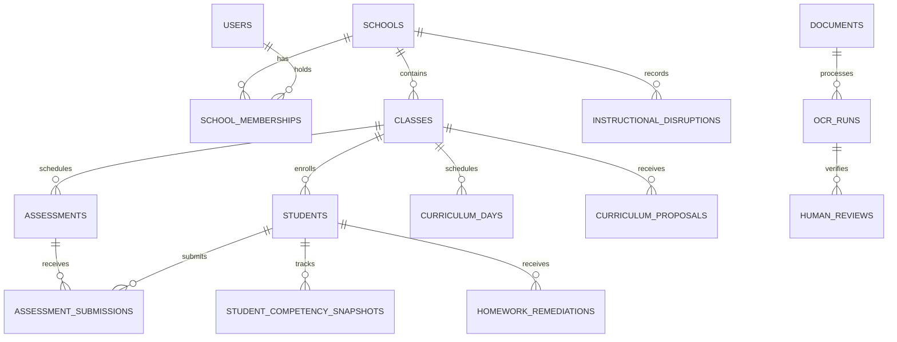

# LumenEIOS Database Schema Reference

## 1. Relational Architecture Overview

The LumenEIOS database is designed in third normal form (3NF) to support multi-school tenant isolation, academic calendar pacing, assessment lifecycle, student competency tracking across the 4 core dimensions (LU, CU, AU, CT), OCR extractions, and model evaluation telemetry.

---

## 2. Table Specifications

### 2.1 `schools`
Stores institutional profile, tier, and official annual instructional calendar.
- `id` (VARCHAR 64, PK): Unique school identifier (e.g., `school-1`).
- `name` (VARCHAR 255): Institutional name.
- `location` (VARCHAR 255): City/district address.
- `state` (VARCHAR 100): State/UT in India.
- `infrastructure_tier` (VARCHAR 50): `'high-tech'`, `'standard'`, or `'low-tech'`.
- `academic_year` (VARCHAR 50): Academic session (default `'2026-2027'`).
- `principal_id` (VARCHAR 64): FK to principal user.
- `principal_name` (VARCHAR 255): Principal's full name.
- `student_count` (INTEGER): Active enrollment.
- `teacher_count` (INTEGER): Faculty count.
- `class_count` (INTEGER): Total sections.
- `pacing_risk` (VARCHAR 50): Pacing status (`'low'`, `'medium'`, `'high'`).
- `official_working_days` (INTEGER): Total sanctioned instructional days (default `220`).
- `is_archived` (BOOLEAN): Soft-delete flag.
- `created_at` (TIMESTAMP): Record creation timestamp.

### 2.2 `users` & `school_memberships`
Handles identity, encrypted credentials, and role memberships.
- `users`:
  - `id` (VARCHAR 64, PK)
  - `email` (VARCHAR 255, UNIQUE, INDEX)
  - `name` (VARCHAR 255)
  - `hashed_password` (VARCHAR 255)
  - `role` (VARCHAR 50, INDEX): `'admin'`, `'principal'`, `'teacher'`, `'student'`, `'parent'`.
  - `school_id` (VARCHAR 64, FK `schools.id`): Primary campus.
  - `designation` (VARCHAR 255)
  - `avatar` (VARCHAR 512)
- `school_memberships`:
  - `id` (VARCHAR 64, PK)
  - `user_id` (VARCHAR 64, FK `users.id`)
  - `school_id` (VARCHAR 64, FK `schools.id`)
  - `role` (VARCHAR 50)
  - `is_active` (BOOLEAN)

### 2.3 `classes` & `subjects`
- `classes`:
  - `id` (VARCHAR 64, PK)
  - `school_id` (VARCHAR 64, FK `schools.id`)
  - `grade` (INTEGER): Academic standard (e.g. 8).
  - `section` (VARCHAR 10): Section label (e.g. `'A'`).
  - `name` (VARCHAR 100): Friendly label (e.g. `'Class 8-A'`).
  - `class_teacher_id` (VARCHAR 64): Lead teacher user ID.
  - `class_teacher_name` (VARCHAR 255)
  - `student_count` (INTEGER)
  - `subject_ids_json` (JSON): List of subject IDs taught in class.
- `subjects`:
  - `id` (VARCHAR 64, PK)
  - `name` (VARCHAR 100)
  - `code` (VARCHAR 50, UNIQUE)
  - `grade` (INTEGER)
  - `icon_name` (VARCHAR 50)

### 2.4 `students` & `parent_student_links`
- `students`:
  - `id` (VARCHAR 64, PK)
  - `school_id` (VARCHAR 64, FK `schools.id`)
  - `class_id` (VARCHAR 64, FK `classes.id`)
  - `class_name` (VARCHAR 100)
  - `name` (VARCHAR 255, INDEX)
  - `roll_no` (INTEGER)
  - `gender` (VARCHAR 20)
  - `attendance_pct` (FLOAT)
  - **Live Competencies**: `lu_score`, `cu_score`, `au_score`, `ct_score`, `overall_score` (INTEGER 0-100)
  - **Diagnostic Baseline**: `baseline_lu`, `baseline_cu`, `baseline_au`, `baseline_ct`, `baseline_overall`
  - `learning_modality` (VARCHAR 50): `'Visual'`, `'Auditory'`, `'Reading/Writing'`, `'Kinesthetic'`.
  - `parent_id` (VARCHAR 64): FK to linked parent user.
  - `homework_completion_rate` (FLOAT)
  - `needs_support` (BOOLEAN)
  - `support_area` (TEXT)
- `parent_student_links`:
  - `id` (VARCHAR 64, PK)
  - `parent_user_id` (VARCHAR 64, FK `users.id`)
  - `student_id` (VARCHAR 64, FK `students.id`)

### 2.5 `instructional_disruptions`
Records lost teaching periods for pacing recalibration.
- `id` (VARCHAR 64, PK)
- `school_id` (VARCHAR 64, FK `schools.id`)
- `date` (VARCHAR 20): Date of interruption (`YYYY-MM-DD`).
- `reason` (VARCHAR 100): Categorical reason (e.g., `'Election Duties'`, `'Extreme Weather'`).
- `days_lost` (FLOAT): Contact days lost.
- `recorded_by` (VARCHAR 255): Name of reporting educator.
- `notes` (TEXT)

### 2.6 `assessments` & `assessment_submissions`
- `assessments`:
  - `id` (VARCHAR 64, PK)
  - `school_id` (VARCHAR 64, FK `schools.id`)
  - `class_id` (VARCHAR 64, FK `classes.id`)
  - `subject_id` (VARCHAR 64)
  - `title` (VARCHAR 255)
  - `cycle_number` (INTEGER): Periodic assessment cycle (1-4).
  - `date` (VARCHAR 20)
  - `duration_minutes` (INTEGER)
  - `total_marks` (INTEGER)
  - `status` (VARCHAR 50): `'scheduled'`, `'graded'`, `'closed'`.
  - `competency_focus_json` (JSON): Targeted dimensions (`['LU', 'CU', 'AU', 'CT']`).
  - `questions_json` (JSON): Bank of questions with marks and Bloom levels.
- `assessment_submissions`:
  - `id` (VARCHAR 64, PK)
  - `assessment_id` (VARCHAR 64, FK `assessments.id`)
  - `student_id` (VARCHAR 64, FK `students.id`)
  - `student_name` (VARCHAR 255)
  - `marks_obtained` (INTEGER)
  - `total_marks` (INTEGER)
  - `percentage` (INTEGER)
  - `lu_score`, `cu_score`, `au_score`, `ct_score`, `overall_score` (INTEGER)
  - `feedback` (TEXT)
  - `submission_date` (VARCHAR 20)
  - `is_scanned` (BOOLEAN)

### 2.7 `student_competency_snapshots`
Immutable historical log of competency measurements across cycles.
- `id` (VARCHAR 64, PK)
- `student_id` (VARCHAR 64, FK `students.id`)
- `cycle_number` (INTEGER)
- `recorded_at` (TIMESTAMP)
- `lu_score`, `cu_score`, `au_score`, `ct_score`, `overall_score` (INTEGER)
- `notes` (TEXT)

### 2.8 `curriculum_days` & `curriculum_proposals`
- `curriculum_days`:
  - `id` (VARCHAR 64, PK)
  - `day_number` (INTEGER, INDEX): 1 to 180.
  - `class_id` (VARCHAR 64, INDEX)
  - `subject_id` (VARCHAR 64)
  - `topic` (VARCHAR 255)
  - `objective` (TEXT)
  - `teaching_process` (TEXT)
  - `measurable_outcome` (TEXT)
  - `estimated_duration_mins` (INTEGER)
  - `vark_modality` (VARCHAR 50)
  - `bloom_level` (VARCHAR 50)
  - `classification` (VARCHAR 50): `'core'` or `'supplementary'`.
  - `status` (VARCHAR 50): `'completed'`, `'in-progress'`, `'pending'`, `'compressed_to_homework'`, `'integrated'`.
  - `prerequisites_json` (JSON)
- `curriculum_proposals`:
  - `id` (VARCHAR 64, PK)
  - `school_id` (VARCHAR 64, INDEX)
  - `class_id` (VARCHAR 64, INDEX)
  - `version_number` (INTEGER)
  - `original_duration_days` (INTEGER)
  - `revised_duration_days` (INTEGER)
  - `days_saved` (INTEGER)
  - `topics_preserved_count` (INTEGER)
  - `topics_reassigned_count` (INTEGER)
  - `topics_integrated_count` (INTEGER)
  - `status` (VARCHAR 50): `'pending'`, `'approved'`, `'rejected'`.
  - `trade_offs_json` (JSON)
  - `remediation_requirements_json` (JSON)
  - `reassigned_topic_ids` (JSON)
  - `integrated_topic_ids` (JSON)
  - `approved_by` (VARCHAR 255)
  - `approved_at` (TIMESTAMP)

### 2.9 `documents`, `ocr_runs`, `human_reviews` & `model_evaluations`
- `documents`: Stores optical answer script file metadata and storage paths.
- `ocr_runs`: Extraction telemetry, bounding boxes, text transcribing, and model versions.
- `human_reviews`: Teacher verification records confirming marks and handwriting ground truth.
- `dataset_examples`: Partitioned ground truth training samples (train/val/test).
- `model_evaluations`: CER, WER, field accuracy, latency benchmarks.
- `model_deployments`: Active production model registry with rollback support.

### 2.10 `audit_events` & `notifications`
- `audit_events`: System audit log capturing user actions, timestamps, and categories.
- `notifications`: User inbox alerts for pacing risks, homework assignments, and assessment results.

