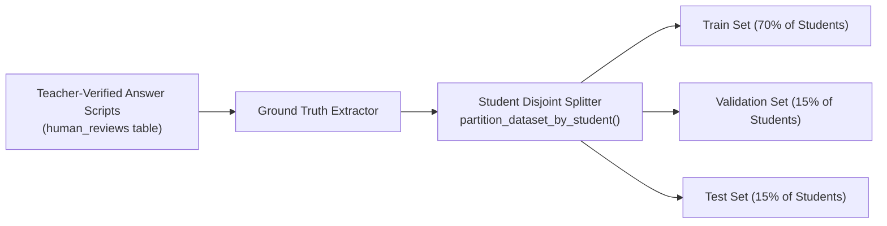

# Model Fine-Tuning & Evaluation Pipeline

## 1. Ground Truth Curation & Student-Level Partitioning

A critical pitfall in machine learning for educational handwriting recognition is **student leakage** across splits. When handwriting samples from the same student appear in both the training and evaluation sets, models memorize idiosyncratic penmanship quirks rather than generalizing across diverse student handwritings.

### Partitioning Invariant
The `ModelTrainingService` enforces **Student-Level Disjoint Partitioning**:
- All samples belonging to student $S_i$ are assigned exclusively to **one** split: `train` (70%), `validation` (15%), or `test` (15%).
- Mathematically: $\text{Students}(\text{Train}) \cap \text{Students}(\text{Test}) = \emptyset$.



---

## 2. Evaluation Metrics: CER & WER

Model performance is quantified using Character Error Rate (CER) and Word Error Rate (WER) computed via Levenshtein edit distance:

$$\text{CER} = \frac{S_c + D_c + I_c}{N_c}$$

$$\text{WER} = \frac{S_w + D_w + I_w}{N_w}$$

Where:
- $S$: Substitutions
- $D$: Deletions
- $I$: Insertions
- $N$: Total characters / words in reference ground truth

---

## 3. Production Promotion Gates

To prevent regression, candidate models must pass strict automated quality gates before activation:

| Benchmark Criterion | Threshold | Rationale |
|:---|:---:|:---|
| **Character Error Rate (CER)** | $\le 5.0\%$ | Ensures names, mathematical symbols, and keywords are transcribed legibly. |
| **Word Error Rate (WER)** | $\le 12.0\%$ | Protects multi-word conceptual justifications from semantic degradation. |
| **Field Accuracy** | $\ge 90.0\%$ | Bounding-box and key-value alignment across standardized worksheets. |
| **Inference Latency** | $\le 500\text{ ms}$ | Interactive review workflow responsiveness for rural school educators. |

```python
def check_model_promotion_criteria(cer: float, wer: float, field_accuracy: float) -> Tuple[bool, str]:
    if cer > 0.05:
        return False, f"Failed promotion: CER ({cer*100:.1f}%) exceeds 5.0% threshold."
    if wer > 0.12:
        return False, f"Failed promotion: WER ({wer*100:.1f}%) exceeds 12.0% threshold."
    if field_accuracy < 0.90:
        return False, f"Failed promotion: Field accuracy ({field_accuracy*100:.1f}%) below 90.0% threshold."
    return True, "Model passed all benchmark gates for production deployment."
```

---

## 4. Model Registry & Instant Rollback

The model registry tracks model versions in `model_deployments`:
- **Promotion**: When a new candidate passes benchmarking and receives administrative approval, its `is_active` flag is set to `True`, and previous deployments are deactivated.
- **Instant Rollback**: If unexpected regressions occur in production, administrators can trigger `POST /api/v1/model-registry/rollback`, reactivating the previous certified model version within seconds without downtime.

