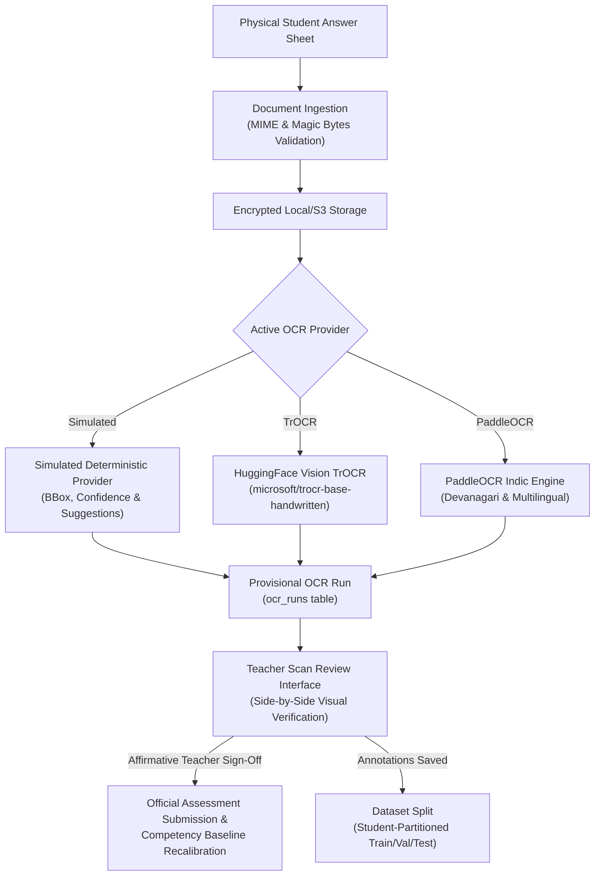

# Optical Assessment (OCR) Pipeline & Human Review

## 1. Overview & Non-Negotiable Invariants

The LumenEIOS Optical Assessment Pipeline transcribes handwritten and printed student test sheets into structured digital evaluation records. It enables low-tech and hybrid schools to administer paper-based formative assessments while benefiting from competency analytics.

### Non-Negotiable Pedagogical Invariant
> **Human-in-the-Loop Verification**: An AI or OCR model is NEVER permitted to independently publish marks, modify competency records, or alter student masteries. Every machine transcription produces a provisional preview that requires affirmative verification by an authorized educator.



---

## 2. Ingestion & Security Validation

Before any OCR model processes an incoming scan, the `StorageService` performs rigorous sanity checks:
1. **Magic Bytes Validation**: Verifies initial binary signatures for JPEG (`FF D8 FF`), PNG (`89 50 4E 47`), and PDF (`25 50 44 46`).
2. **File Size Limit**: Rejects files exceeding 25 MB.
3. **Private File Path Generation**: Strips path traversal sequences (`../`, `..\\`) and assigns UUID-based namespaces within restricted storage volumes.

---

## 3. Pluggable Provider Architecture

The pipeline implements the `BaseOCRProvider` interface, allowing hot-swapping between models via configuration:

```python
class BaseOCRProvider(abc.ABC):
    @abc.abstractmethod
    async def extract_document(self, document_path: str, options: Optional[Dict[str, Any]] = None) -> Dict[str, Any]:
        """Returns normalized page regions, bounding boxes, and transcription."""
        raise NotImplementedError
```

### Supported Providers
1. **`SimulatedOCRProvider` (Default Local Mode)**:
   - 100% deterministic, zero external API keys, zero GPUs required.
   - Extracts 4 standard question regions with bounding boxes (`[ymin, xmin, ymax, xmax]`), suggested marks, and target competencies (AU, CU, LU, CT).
   - Designed for instant local stakeholder demos and unit testing.
2. **`TrOCRHuggingFaceProvider`**:
   - Integrates Hugging Face's `microsoft/trocr-base-handwritten` for deep Transformer-based handwriting recognition.
3. **`PaddleOCRProvider`**:
   - Optimized for lightweight on-premise execution with support for regional Indic scripts and mixed vernacular handwriting.

---

## 4. Human-in-the-Loop Review Workflow

1. The educator opens the **Scan Review** interface (`/teacher/scan-review`).
2. The UI renders the optical scan image alongside machine-extracted bounding boxes and suggested item scores.
3. The teacher reviews each answer line, verifies or edits marks, and optionally inputs qualitative feedback.
4. Clicking **"Verify & Save Grades"** triggers `POST /api/v1/ocr/review/verify`.
5. The backend transactionally:
   - Records a `human_reviews` verification log.
   - Updates `assessment_submissions` with the teacher's verified marks.
   - Recalibrates the student's live competencies in `students`.
   - Records an immutable snapshot in `student_competency_snapshots`.
   - Adds the verified text snippet to `dataset_examples` for future model fine-tuning.
   - Emits an `audit_events` trail.

