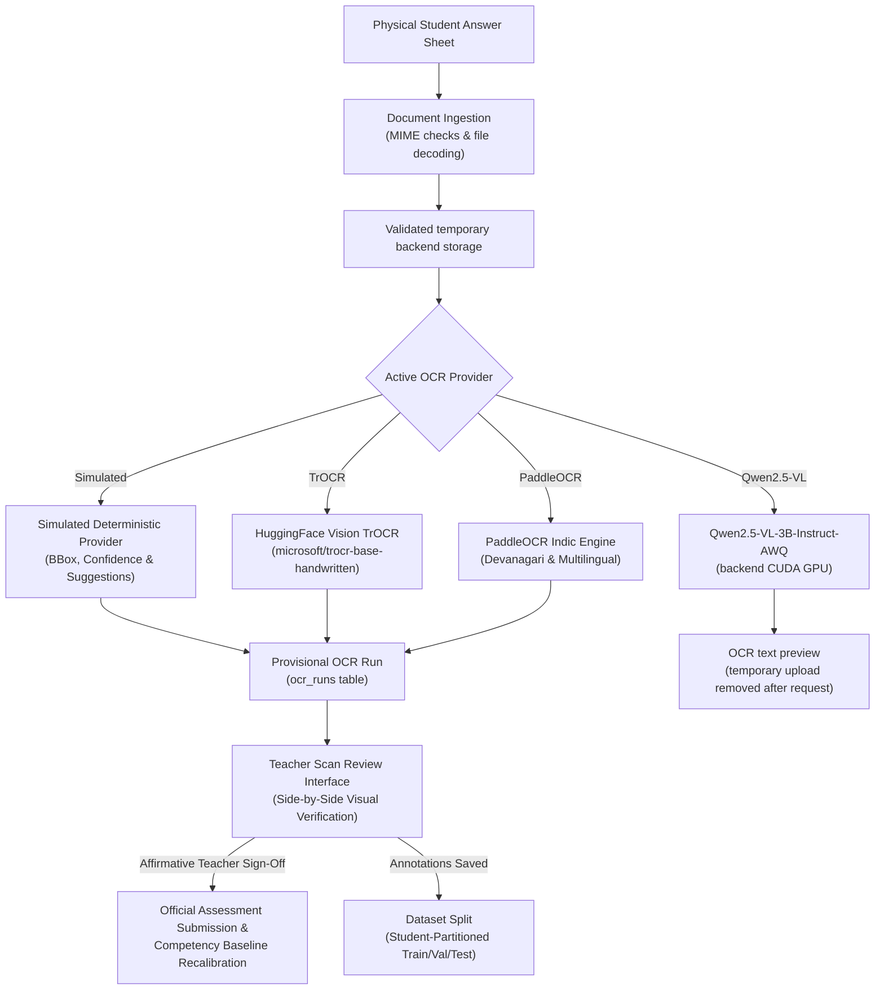

# Optical Assessment (OCR) Pipeline & Human Review

## 1. Overview & Non-Negotiable Invariants

The LumenEIOS Optical Assessment Pipeline transcribes handwritten and printed student test sheets. The Qwen preview workflow returns extracted text for inspection and does not grade or publish marks.

### Non-Negotiable Pedagogical Invariant
> **Human-in-the-Loop Verification**: An AI or OCR model is NEVER permitted to independently publish marks, modify competency records, or alter student masteries. Every machine transcription produces a provisional preview that requires affirmative verification by an authorized educator.



---

## 2. Ingestion & Security Validation

The OCR preview accepts JPG, PNG, and PDF uploads and applies the existing 15 MB per-file limit. `StorageService` assigns UUID-based filenames under its configured backend storage directory. Image and PDF decoding validates that the content can be opened; temporary preview uploads are deleted after processing.

---

## 3. Pluggable Provider Architecture

The pipeline implements the `BaseOCRProvider` interface, allowing hot-swapping between models via configuration:

```python
class BaseOCRProvider(abc.ABC):
    @abc.abstractmethod
    async def extract_document(self, document_path: str, options: Optional[Dict[str, Any]] = None) -> Dict[str, Any]:
        """Returns normalized page regions, bounding boxes, and transcription."""
        raise NotImplementedError
```

### Supported Providers
1. **`SimulatedOCRProvider` (Default Local Mode)**:
   - 100% deterministic, zero external API keys, zero GPUs required.
   - Extracts 4 standard question regions with bounding boxes (`[ymin, xmin, ymax, xmax]`), suggested marks, and target competencies (AU, CU, LU, CT).
   - Designed for instant local stakeholder demos and unit testing.
2. **`TrOCRHuggingFaceProvider`**:
   - Integrates Hugging Face's `microsoft/trocr-base-handwritten` for deep Transformer-based handwriting recognition.
3. **`PaddleOCRProvider`**:
   - Optimized for lightweight on-premise execution with support for regional Indic scripts and mixed vernacular handwriting.
4. **`QwenVisionOCRProvider`**:
   - Uses `Qwen/Qwen2.5-VL-3B-Instruct-AWQ` by default, following the provided notebook's Transformers inference flow.
   - Loads lazily in the FastAPI process and requires CUDA. Missing GPU/dependencies or inference errors are reported; it does not silently substitute simulated OCR.
   - Converts PDF pages to images with PyMuPDF, up to 25 pages per PDF. The optional UI buffer waits five seconds before each image/page.

### Qwen OCR developer preview

Install a CUDA-enabled PyTorch build for the laptop, then install `backend/requirements-ocr.txt`. Run FastAPI on the laptop so inference uses its local GPU; production uses the same server-side provider on the backend host. The browser uploads files to `POST /api/v1/ocr/extract-preview`, and the backend returns each file's transcription to the **OCR Extraction Preview** panel. This endpoint is OCR-only: it does not persist grades, call the grading pipeline, or publish marks.

---

## 4. OCR Preview and Existing Human Review

The current **Scan Review** screen (`/teacher/scan-review`) uploads files to `POST /api/v1/ocr/extract-preview` and displays each Qwen transcription in a separate preview panel. It does not award marks or publish results. The separate `POST /api/v1/ocr/review/verify` endpoint remains available for workflows that collect teacher-verified marks; the Qwen preview does not call it.
