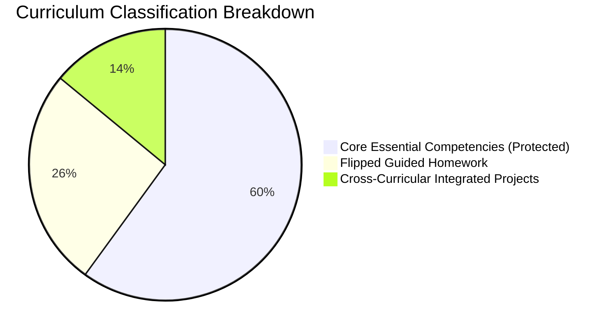

# Time-Aware Pedagogical Engine & 60/40 Syllabus Compression

## 1. Pedagogical Problem Statement

In conventional schooling systems, when unexpected disruptions occur—such as monsoon red alerts, election polling station requisitioning, or mandatory health drives—teachers face intense pressure to "rush through the textbook" before terminal board examinations. This leads to superficial content skimming where students lose foundational understanding, causing learning deficits to compound across grades.

LumenEIOS introduces the **Time-Aware Pedagogical Engine**, an algorithmic calendar optimizer that balances instructional contact days against curriculum demands.

---

## 2. Core Pacing Formulas

$$\text{Gross Remaining Days} = \max(0, \text{Official Working Days} - \text{Current Day})$$

$$\text{Net Instructional Days} = \max(0, \text{Gross Remaining Days} - \sum \text{Lost Days})$$

$$\text{Periods Needed} = \text{Core Topics Remaining} + \text{Supplementary Topics Remaining}$$

$$\text{Pacing Buffer} = \text{Net Instructional Days} - \text{Periods Needed}$$

### Risk Categorization Matrix

| Pacing Buffer | Risk Level | System Action |
|:---|:---:|:---|
| $\text{Buffer} > +3\text{ days}$ | **Low** | On track. Standard instructional pacing maintained. |
| $-3\text{ days} \le \text{Buffer} \le +3\text{ days}$ | **Medium** | Tight pacing alert sent to class teacher and principal. |
| $\text{Buffer} < -3\text{ days}$ | **High** | Critical deficit alert. Engine recommends 60/40 Syllabus Compression. |

---

## 3. The 60/40 Syllabus Compression Algorithm

When pacing deficits occur, the engine constructs a structured compaction proposal rather than randomly omitting chapters:

### Invariant Rules
1. **100% Core Competency Protection**: All essential foundational outcomes designated as `'core'` remain scheduled during live classroom contact hours with the educator. They are never dropped or relegated to unguided self-study.
2. **Reallocation of Supplementary Topics**: Supplementary and exploratory inquiry topics (`'supplementary'`) are systematically converted into:
   - **Guided Flipped Homework**: Structured worksheets with clear rubric-based self-checks.
   - **Cross-Curricular Synergy Modules**: Multi-disciplinary projects combining concepts across Mathematics, Science, and Social Studies to recover contact hours without eliminating outcomes.

---

## 4. Multi-Stakeholder Approval Lifecycle

Curriculum changes require affirmative educator approval before taking effect:
1. **Engine Proposal**: `POST /api/v1/classes/{class_id}/time-aware/compression-preview` generates a detailed proposal with trade-offs and remediation requirements.
2. **Educator Review**: The teacher or principal examines the proposal in the **Syllabus Compression Preview** modal.
3. **Approval & Atomic Execution**: Calling `POST /api/v1/curriculum-proposals/{id}/approve` transactionally updates topic classifications in the 180-day calendar and logs an immutable audit entry.

